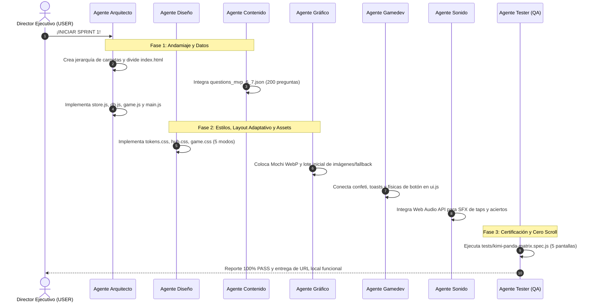

# 📜 Órdenes Operativas Oficiales — SPRINT 1: "Kimi Panda" (MVP Flash PWA)
**Emitidas por:** Consejo Asesor Independiente (Cámara Asesora)  
**Autoridad de Despacho:** Director Ejecutivo (USER)  
**Entornos de Trabajo:** `E:\KimiPanda\` y `e:\Presion Mental APP\Kimi Panda\app\`  
**Estado:** 🔴 URGENTE — PROTOCOLO DE CORRECCIÓN DE 8 BUGS AUDITADOS EN PRODUCCIÓN

> [!IMPORTANT]
> ### 🚨 CHECKLIST PRIORITARIA DE BLOQUEO: 8 BUGS DETECTADOS EN PRODUCCIÓN
> *(Consultar pliego exhaustivo en [`ORDEN_HOTFIX_8_BUGS_PRODUCCION.md`](ORDEN_HOTFIX_8_BUGS_PRODUCCION.md))*
> 1. **[GRÁFICO / ARQUITECTO]** Cero imágenes rotas (404) y preguntas imposibles (ej. "¿Qué forma es esta?"). Estandarizar carpeta `assets/preguntas/` y mapear webp.
> 2. **[ARQUITECTO / DISEÑO]** Erradicar duplicación de texto en la tarjeta: cambiar `alt = q.q` en `game.js` a genérico y ocultar frame si falla la imagen.
> 3. **[DISEÑO / ARQUITECTO]** Limpieza radical de fondo: eliminar `.floating-island` y mochilas flotantes en `index.html`. Fondo limpio `#FFF4E4`.
> 4. **[DISEÑO]** Mochi a escala hero (`min(48vw, 220px)`) con sombra elíptica física en el suelo (`.mochi-shadow`).
> 5. **[DISEÑO / GAMEDEV]** Alinear accesorios en la Tienda: calibrar `.avatar-preview-hat` para que la gorra no flote en el aire.
> 6. **[GRÁFICO / DISEÑO]** Erradicar emojis de sistema (`🦸‍♂️`) en la Tienda y reemplazarlos por íconos SVG/stickers de la estética oficial.
> 7. **[DISEÑO]** Safe-area padding en móviles (`padding-bottom: calc(28px + env(safe-area-inset-bottom))`) para evitar footers cortados.
> 8. **[ARQUITECTO / GAMEDEV]** Corazones de vida en rojo activo al iniciar partida, solo apagándose a gris al fallar.

---

## 🔒 REGLA GENERAL DE AISLAMIENTO PARA TODOS LOS AGENTES
1. **Confinamiento Estricto:** Todas las operaciones de creación y edición de código se realizarán ÚNICAMENTE dentro del directorio `Kimi Panda/app/`.
2. **Cero Acoplamiento:** Queda terminantemente prohibido importar scripts o CSS desde la raíz (`../../css`, `../../js`). Todo recurso debe ser local a `Kimi Panda/app/`.
3. **Preservación del Proyecto Raíz:** La versión previa de Reto Panda en la raíz permanece 100% intacta como backup y línea base.

---

## 🛠️ ORDEN #1: AGENTE ARQUITECTO
**Dominio:** Estructura de archivos, modularización JS (ESM), flujo de datos y PWA base.

### Entregables y Tareas Específicas:
1. **Creación de Jerarquía de Carpetas en `Kimi Panda/app/`:**
   - Crear: `css/`, `js/`, `data/`, `assets/interface/`, `assets/mascotas/`, `assets/preguntas/`, `assets/sounds/`.
2. **Refactorización de `index.html`:**
   - Desacoplar el `<style>` inline y mover las reglas a los archivos correspondientes en `css/`.
   - Estructurar el markup con ``.
   - Incorporar etiquetas semánticas y metadatos PWA (`manifest.json`, viewport con `viewport-fit=cover`).
3. **Módulo de Estado (`js/store.js`):**
   - Estado reactivo local: perfil de jugador (`name`, `age`, `stars`, `hearts`, `highStreak`, `unlockedLevels`).
   - Persistencia segura en `localStorage` con la clave `'kp_profile_v1'`.
   - Métodos atómicos: `addStars(n)`, `decrementHeart()`, `resetHearts()`, `saveProfile()`, `loadProfile()`.
4. **Módulo de Datos Curriculares (`js/db.js`):**
   - Cargar asíncronamente `data/questions_mvp_6_7.json`.
   - Selector inteligente de rondas: función `getRandomRound(count = 6)` que garantice variedad curricular balanceada (máximo 2 por categoría por tanda).
   - Detección de tipo: clasificar si la pregunta contiene `img` o es solo texto para que la UI responda adecuadamente.
5. **Controlador Central (`js/game.js`):**
   - Máquina de estados de ronda: `IDLE` -> `COUNTDOWN` -> `QUESTION_ACTIVE` -> `FEEDBACK` -> `ROUND_SUMMARY`.
   - Gestión de aciertos/errores: tiempo de lectura adaptado, bonificación de +3 estrellas por acierto, descuento de 1 corazón por error con reintento suave.
6. **Módulo Principal (`js/main.js`):**
   - Inicialización de la app, registro de Service Worker (`sw.js`) con estrategia Network-First + Cache Offline.

---

## 🎨 ORDEN #2: AGENTE DISEÑO
**Dominio:** Tokens CSS, estética Chunky Pop y maquetación adaptativa multi-dispositivo (5 Modos).

### Entregables y Tareas Específicas:
1. **Archivo de Tokens (`css/tokens.css`):**
   - Variables maestras:
     - Fondo: `--bg: #FFF4E4` (crema cálido anti-fatiga).
     - Tinta: `--ink: #241C15` (chocolate oscuro), `--bw: 3px`.
     - Push shadow: `--push: 8px 8px 0 0 var(--ink)`.
     - Paleta de acentos: Verde `--green: #37A05C`, Naranja `--orange: #FF8A2A`, Ámbar `--amber: #FFC53D`, Azul `--blue: #3D9BE9`, Púrpura `--purple: #9B6BF3`, Rojo `--red: #F0685F`.
     - Tipografía: `--font-display: 'Fredoka', sans-serif`, `--font-body: 'Nunito', sans-serif`.
2. **Estilos del Hub (`css/hub.css`):**
   - Header de perfil con avatar circular, saludo, nivel/estrellas y botón de ajustes.
   - Hero con Mochi flotante y burbuja de diálogo con cola centrada (`pop` animation).
   - Menú 2×2 de botones mecánicos (`Mundos`, `Juego Libre`, `Tienda`, `Logros`).
   - Tarjeta de misiones semanales con barras de progreso y recompensas de estrellas.
3. **Estilos de Juego y Tarjeta Adaptativa (`css/game.css`):**
   - **Componente `.qcard` Adaptativo:**
     - `.qcard.text-only`: Texto de pregunta grande (`clamp(40px, 12vw, 56px)`).
     - `.qcard.has-image`: Contenedor `.q-media-frame` (alto máx 135px, `object-fit: contain`) y texto mediano (`clamp(20px, 4.8vw, 28px)`).
   - Cuadrícula de respuestas `.answers` en 2×2 con botones push mecánicos:
     - Estado `:hover`: brillo sutil.
     - Estado `:active`: `transform: translate(0,0); box-shadow: 0 0 0 0;`.
     - Clases de feedback: `.correct` (verde + tada), `.wrong` (rojo + shake).
4. **Matriz Responsiva de 5 Modos:**
   - **Desktop (`@media (min-width: 900px)`):** Contenedor máx. 920px centrado, botones de 64px, espaciado generoso.
   - **Tablet Portrait (`@media (min-width: 600px) and (orientation: portrait)`):** Máx. 640px, botones táctiles grandes (72px alto).
   - **Tablet Landscape (`@media (min-width: 900px) and (orientation: landscape)`):**
     - Hub en Split Screen 50/50.
     - Juego en 2 columnas (Izquierda: `.qcard` con imagen; Derecha: 4 opciones de respuesta). Cero scroll.
   - **Móvil Portrait (`@media (max-width: 480px) and (orientation: portrait)`):** Flujo vertical en `100dvh`, imagen ≤130px, botones al alcance del pulgar.
   - **Móvil Landscape (`@media (max-height: 480px) and (orientation: landscape)`):** Modo 2 pulgares: HUD de 32px, split screen 50/50 (pregunta compacta izq + 4 botones compactos der).

---

## 📚 ORDEN #3: AGENTE CONTENIDO
**Dominio:** Banco de preguntas curricular y adaptación de datos.

### Entregables y Tareas Específicas:
1. **Archivo de Preguntas (`Kimi Panda/app/data/questions_mvp_6_7.json`):**
   - Extraer las 200 preguntas depuradas de `assets/data/db_mvp_6_7.json` y estructurarlas en formato unificado JSON en la carpeta local.
2. **Normalización de Contratos:**
   - Cada ítem debe contener: `id`, `q` (texto pregunta), `opts` (array de 4 opciones), `correct` (índice 0-3), `cat` (categoría: ciencias, historia, ingles, lenguaje, logica, matematicas), `oa` (código curricular Mineduc), `img` (ruta relativa `assets/preguntas/...` si aplica, o `null`).
3. **Auditoría de Textos:**
   - Revisión ortográfica estricta infantil (tildes, mayúsculas correctas, vocabulario cercano para niños de 6 a 7 años de Chile).

---

## 🖼️ ORDEN #4: AGENTE GRÁFICO
**Dominio:** Renders de Mochi, iconografía SVG chunky y preparación del pipeline de imágenes de preguntas.

### Entregables y Tareas Específicas:
1. **Avatar y Mascota Mochi (`Kimi Panda/app/assets/mascotas/`):**
   - Exportar/adaptar los renders WebP de Mochi con fondo transparente:
     - `mochi_hub.webp`: Mochi explorador saludando (resolución optimizada ≤ 180 KB).
     - `mochi_celebrate.webp`: Mochi saltando de alegría (para pantalla de victoria/feedback).
     - `mochi_thinking.webp`: Mochi con expresión de curiosidad.
2. **Iconografía SVG Chunky (`Kimi Panda/app/assets/interface/`):**
   - Generar/limpiar los iconos SVG integrados con trazo grueso (`stroke-width: 2.2`, contorno `#241C15`): mapa de mundos, dado de juego libre, carrito de tienda, trofeo de logros, engranaje de ajustes, estrella dorada y corazón de vida.
3. **Primer Lote de 20 Imágenes Prioritarias de Preguntas (`assets/preguntas/`):**
   - Procesar y colocar las 20 imágenes prioritarias identificadas en el catálogo (Ciencias y Lógica) en formato WebP transparente de 512×512 px.
4. **Fallback Universal SVG para Imágenes Pendientes:**
   - Proveer un sistema de fallback con insignias tipo sticker temáticas por asignatura para las preguntas restantes del catálogo mientras se completa el lote masivo.

---

## 🕹️ ORDEN #5: AGENTE GAMEDEV (RP DESARROLLO)
**Dominio:** Game feel, física de micro-interacciones, "Juice" y ciclo de recompensa.

### Entregables y Tareas Específicas:
1. **Micro-interacciones y Timing de Animación:**
   - Calibrar la curva elástica de entrada de pantallas y botones: `cubic-bezier(0.34, 1.56, 0.64, 1)`.
   - Ajustar el retardo de transición tras acierto: 1400ms para permitir que el niño disfrute el confeti y el toast antes del cambio de pregunta.
   - Ajustar el tiempo de desbloqueo tras error: 900ms con re-habilitación limpia de los botones sin penalización de vidas extra.
2. **Sistema de Partículas de Confeti (`js/ui.js`):**
   - Generación de 26 partículas livianas en forma de estrellitas y círculos de colores pasteles con rotación y caída fluida, auto-removibles del DOM a los 2.6 segundos.
3. **Toast Flotante Dinámico:**
   - Notificación pop-up con frases positivas aleatorias de refuerzo: *"¡Increíble! +3 ⭐"*, *"¡Genial! +3 ⭐"*, *"¡Seco! +3 ⭐"*, *"¡Fantástico! +3 ⭐"*.

---

## 🔊 ORDEN #6: AGENTE SONIDO (AUDIO DEV)
**Dominio:** Ergonomía acústica infantil y paisajes sonoros livianos.

### Entregables y Tareas Específicas:
1. **Módulo de Audio Liviano (`js/audio.js`):**
   - Implementar sintetizador de efectos con **Web Audio API** nativa (cero descargas de archivos pesados) o micro-muestras de audio comprimidas en MP3/Ogg (< 20 KB cada una).
   - Efectos requeridos:
     - `sfxPop()`: Tono corto y alegre al presionar botones mecánicos.
     - `sfxCorrect()`: Acorde mayor brillante arpegiado (Do - Mi - Sol) para acierto.
     - `sfxWrongSoft()`: Tono grave suave y amortiguado (no traumático) al errar.
     - `sfxStar()`: Tintineo metálico dulce al sumar estrellas.
2. **Interruptor Global:**
   - Botón de silencio accesible desde el HUD respetando la preferencia del usuario en `localStorage`.

---

## 🧪 ORDEN #7: AGENTE TESTER (QA)
**Dominio:** Automatización de pruebas, verificación de cero scroll y certificación multidispositivo.

### Entregables y Tareas Específicas:
1. **Suite Automatizada Playwright (`tests/kimi-panda-matrix.spec.js`):**
   - Configurar pruebas específicas para la URL local `http://localhost:8080/Kimi%20Panda/app/index.html`.
2. **Casos de Prueba Críticos:**
   - **`T-KP-01` (Cero Scroll en los 5 Modos):** Validar que `document.body.scrollHeight <= window.innerHeight` en Desktop (1440×900), Tablet Portrait (800×1280), Tablet Landscape (1024×768), Móvil Portrait (390×844) y Móvil Landscape (844×390).
   - **`T-KP-02` (Flujo de Juego Completo):** Inicio de ronda de 6 preguntas -> 6 aciertos -> verificación de suma de 18 estrellas -> pantalla final -> regreso al Hub.
   - **`T-KP-03` (Conmutación Imagen/Texto):** Verificar que una pregunta con imagen renderice `.qcard.has-image` sin romper botones, y que la siguiente de solo texto renderice `.qcard.text-only`.
   - **`T-KP-04` (Persistencia Offline):** Recarga de página y confirmación de que las estrellas se mantienen intactas en `localStorage`.

---

## ⏱️ ORDEN SECUENCIAL DE EJECUCIÓN (Fases Operativas)

Una vez que el Director Ejecutivo dé la orden de inicio, los agentes intervendrán en el siguiente orden estricto:

---

## 🚨 CHECKLIST OBLIGATORIA: 8 BUGS AUDITADOS EN PRODUCCIÓN
*Origen: Capturas de pantalla enviadas por el Director Ejecutivo desde sebastiancortesibacache.github.io.*  
*Todos los agentes deben verificar y subsanar estos 8 puntos antes de considerar completado el Sprint 1:*

1. **[CRÍTICO - ARQUITECTO / CONTENIDO] Cero Imágenes Rotas (404) y Cero Preguntas Incompletas:**
   - La pregunta *"¿Qué forma es esta?"* y similares no pueden fallar.
   - Si la imagen aún no está en `assets/preguntas/`, el motor DEBE mostrar un fallback gráfico vectorial limpio, NUNCA el icono roto del navegador.
2. **[CRÍTICO - ARQUITECTO / DISEÑO] Erradicar Duplicación de Texto de Pregunta:**
   - El texto de la pregunta solo se inyecta UNA vez en `#q-text`. No concatenar texto en `alt` ni duplicar cadenas en el markup.
3. **[CRÍTICO - DISEÑO] Limpieza Radical del Fondo (Cero Elementos Flotantes Rotos):**
   - Eliminar mochilas rojas e islas verdes sueltas flotando en el cielo o detrás de las tarjetas. El fondo debe ser un cielo crema suave (`#FFF4E4`) con halos difusos sutiles (`.blob`), sin formas parásitas que ensucien la UI.
4. **[DISEÑO] Escala y Apoyo de Mochi en el Hero:**
   - Mochi no puede verse diminuto ni flotando en el aire. Escala hero adecuada (`min(46vw, 220px)`), centrado con sombra de contacto bajo sus pies.
5. **[DISEÑO / GRÁFICO] Alineación de Accesorios en Tienda (Fix Gorra Voladora):**
   - Los sombreros y accesorios en el avatar de la Tienda deben calzar exactamente sobre la cabeza de Mochi, eliminando el bug donde la gorra flota a la derecha en el vacío.
6. **[GRÁFICO / DISEÑO] Erradicación de Emojis Clipart Inconsistentes:**
   - Reemplazar el emoji `🦸‍♂️` de la Capa Voladora y cualquier clipart genérico por stickers coherentes con el nuevo estilo chunky pop.
7. **[DISEÑO] Safe-Area Padding y Cero Textos Cortados en Footer:**
   - Añadir `padding-bottom: calc(28px + env(safe-area-inset-bottom))` en Home y Tienda para que ningún ítem quede cortado ni tape el texto del pie de página.
8. **[ARQUITECTO / GAMEDEV] Lógica Visual de Corazones de Vida:**
   - Verificar que al iniciar partida los corazones se dibujen llenos (rojos) y solo se apaguen (grises) cuando el jugador falle una pregunta.

