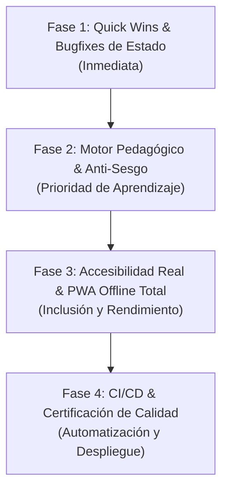

# 📋 PLAN MAESTRO DE REMEDIACIÓN INTEGRAL — AUDITORÍA EXTERNA
## Kimi Panda — Hacia la Certificación Pedagógica y de Calidad v1.2.0
**Autoridad:** Consejo Asesor & Consultor Estratégico  
**Destinatario:** Cuerpo Operativo (Arquitecto, Contenido, Diseño, Gráfico, Tester, Sonido, Release)  
**Sede Canónica Única:** `E:\KimiPanda\`  
**Fecha:** 22 de Octubre, 2026  

---

## 🎯 1. Contexto y Diagnóstico de la Auditoría Externa

Una auditoría externa independiente evaluó a Kimi Panda otorgándole una calificación de **6,5 / 10** (*"MVP prometedor con acabado visual de excelencia, pero con brechas críticas entre lo prometido en la documentación y lo implementado en el código"*).

### Puntos Fuertes Destacados por la Auditoría:
- Identidad visual sobresaliente, cálida, táctil y coherente (*Clay World*).
- Mecánica no punitiva bien pensada para 6-7 años (3 corazones, Segunda Oportunidad de Mochi, sin "Game Over", estrellas de perseverancia).
- Arquitectura modular ESM sin dependencias pesadas en tiempo de ejecución.
- Audio 100% sintetizado con Web Audio API (cero latencia, cero archivos de audio externos).
- Manejo defensivo de errores y modo offline base.

### Brechas Críticas a Resolver Obligatoriamente:
1. **Sesgo Masivo de Posición:** El 64% de las preguntas tienen la respuesta correcta en la posición 2 (en Lenguaje el 96% y en Ciencias el 87%). Las opciones nunca se barajan en tiempo de ejecución.
2. **Progresión de Mundos Inerte:** `startWorldRound` recibe `level` pero nunca lo usa. Los 30 nodos del mapa son réplicas aleatorias sin escalamiento de dificultad (`diff` ignorado).
3. **Fuga en Reinicio de Perfil:** `loadProfile` usa copia superficial y `resetProfile` no reinicia `worldLevels`, heredando mundos entre estudiantes en la misma tablet.
4. **Accesibilidad WCAG 2.2 Inexacta:** Contraste tipográfico insuficiente en botones (.pbtn blanco sobre naranja/azul/verde), zoom bloqueado por `user-scalable=no`, elementos con `role="button"` sin eventos de teclado.
5. **Dependencia Externa en PWA:** Google Fonts no es offline-first y 103 imágenes didácticas no están en el precache inicial.
6. **Bugs de Lógica Menores:** Rango que baja de Exploradora a Novata al primer acierto, racha de aciertos no contabilizada en `highStreak`, modal de 0 vidas que bloquea la app al pulsar Escape.

---

## 🗺️ 2. Estructura de Fases de Ejecución

---

## ⚙️ 3. Asignación Detallada por Agente Operativo

### 🏗️ AGENTE ARQUITECTO
*Archivos asignados:* `js/store.js`, `js/game.js`, `js/db.js`, `package.json`

1. **Blindaje de Estado (`js/store.js`):**
   - Utilizar `structuredClone(DEFAULT_PROFILE)` en `loadProfile()` y `resetProfile()` para erradicar la mutación compartida por referencia.
   - En `resetProfile()`, reiniciar explícitamente `worldLevels: { inicio: 1, matematicas: 1, ciencias: 1, logica: 1, lenguaje: 1, historia: 1 }`.
   - Corregir rangos: Nivel 1 = "Novata", Nivel 2 = "Exploradora", Nivel 3 = "Aventurera", Nivel 4 = "Maestra Panda", Nivel 5 = "Gran Sabia". Rango inicial: "Novata".
   - Incrementar `streak` y actualizar `highStreak = Math.max(highStreak, streak)` en cada acierto correcto. Reiniciar `streak = 0` en fallos.
   - En `resetProfile()`, invocar `setMuted(false)` para sincronizar el estado físico de audio.
2. **Motor Anti-Sesgo y Barajado en Runtime (`js/game.js`):**
   - Implementar el algoritmo **Fisher-Yates Shuffle** al instanciar las 4 opciones de cada pregunta en `loadQuestion(index)`.
   - Identificar la opción correcta comparando el texto con la respuesta original (`q.opts[q.correct]`), de modo que la posición sea dinámicamente variable y completamente impredecible (25% equitativo).
3. **Progresión de Dificultad en Mundos (`js/game.js` y `js/db.js`):**
   - Actualizar `getCategoryRound(category, count, level)`:
     - Niveles 1 y 2: filtrar preguntas con `diff: "easy"`.
     - Niveles 3 y 4: filtrar preguntas con `diff: "medium"`.
     - Nivel 5: preguntas mixtas o desafío final.
4. **Resiliencia de Modales y Rondas (`js/game.js`):**
   - Escuchar el evento `'cancel'` en `#mochi-help-modal` para que presionar Escape no deje los botones deshabilitados.
   - En `showRoundSummary()`, configurar `btnDone.onclick` para volver a `scr-worlds` si `currentWorldId` está activo, o a `scr-hub` en juego libre.
   - Ajustar la barra de progreso de ronda para que el paso final alcance el 100%.
   - Implementar token de ronda para cancelar `setTimeout` huérfanos al salir anticipadamente.
5. **Configuración de Módulo (`package.json`):**
   - Incorporar `"type": "module"` en `package.json`.

---

### 🧠 AGENTE CONTENIDO
*Archivos asignados:* `data/questions_mvp_6_7.json`, `CATALOGO_IMAGENES_PREGUNTAS.md`

1. **Rebalanceo de Semilla del Banco (200 Preguntas):**
   - Modificar el orden estático de `opts` y el índice `correct` en `questions_mvp_6_7.json` para que la distribución de partida sea exactamente **25% en cada posición (0, 1, 2 y 3)** en todas las asignaturas.
2. **Revisión de Textos Huérfanos:**
   - Reescribir o contextualizar las 11 preguntas que hacen alusión a lecturas no presentes en la pantalla (poema "Cosecha", "gallina Pintadita", "Walter", etc.), garantizando que la pregunta sea 100% autónoma.
3. **Calibración Cognitiva y Longitud:**
   - Acortar preguntas y opciones que superan los 80 caracteres para evitar desbordes visuales en pantallas pequeñas y sobrecarga en niños de 6-7 años.
4. **Desobstrucción de Pistas:**
   - Reformular las 5 pistas que soplaba literalmente la respuesta ("caracolito", "marraqueta", etc.) reemplazándolas por guías pedagógicas que inviten a reflexionar.
5. **Etiquetado Curricular de Dificultad:**
   - Catalogar con precisión el campo `diff` (`"easy"` o `"medium"`) para respaldar la progresión real del Modo Mundos.

---

### 🎨 AGENTE DISEÑO
*Archivos asignados:* `css/tokens.css`, `css/hub.css`, `css/game.css`, `index.html`

1. **Definición de Variables Faltantes (`css/tokens.css`):**
   - `--cream: #FFFDF8;`
   - `--r-xl: 36px;`
   - `--coral: #FF6B6B;`
   - `--coral-d: #D9534F;`
2. **Calibración de Contraste Tipográfico WCAG 2.2 AA:**
   - Ajustar las combinaciones de color en botones `.pbtn`:
     - Incorporar texto en tinta oscura `--ink` (#241C15) en botones de fondos luminosos (naranja, azul, ámbar, verde) o aplicar sombras interiores/bordes que garanticen ratio de contraste $\ge 4.5:1$.
     - Ajustar el anillo de foco visible (`:focus-visible`) para que supere el ratio de 3:1 sobre el fondo crema.
3. **Ergonomía Táctil y Accesibilidad:**
   - Aumentar el área de toque mínima a **44×44 px** en `.lvl-node`, `.helper-btn`, `.mission-claim-btn` y botones de acción.
   - Ajustar el tamaño de letra en textos secundarios a un mínimo de 14-16 px para lectura cómoda en primeros lectores.
   - En `index.html`, retirar `user-scalable=no` del viewport para permitir zoom de accesibilidad (WCAG 1.4.4).
4. **Soporte de Teclado y ARIA:**
   - Agregar eventos de teclado (`keydown` para Enter / Espacio) en `#hub-profile-btn`, `#hub-level-pill` y `#hub-mascot`.
   - Añadir `aria-live="polite"` en `#q-hint-box` y actualizar dinámicamente `aria-valuenow` en barras de progreso y corazones.

---

### 🖼️ AGENTE GRÁFICO & BLENDER 3D
*Archivos asignados:* `assets/mascotas/`, `assets/iconos/`, `tools/blender/`

1. **Limpieza de Assets Obsoletos:**
   - Eliminar `assets/panda-wave.png` (1.46 MB) y `mochi_tryagain.webp` huérfanos.
2. **Optimización de Resolución y Memoria de Skins:**
   - Generar versiones reducidas de los avatares de trajes de Mochi a **128×128 px** (para HUD y diorama) y **256×256 px**, reduciendo el consumo de memoria RAM de 75 MB a menos de 4 MB en tablets escolares.
3. **Favicon e Iconografía Liviana:**
   - Crear favicon dedicado de 32×32 px (PNG/SVG) de menos de 5 KB.
4. **Fidelidad Ilustrativa:**
   - Revisar y corregir `mvp_ciencias_001.webp` para que represente de forma didáctica al ave "siete colores" de Chile.

---

### 🎵 AGENTE SONIDO (AUDIO DEV)
*Archivos asignados:* `js/audio.js`, `js/speech.js`

1. **Lector de Preguntas por Voz (TTS Infantil):**
   - Implementar un módulo de síntesis de voz accesible (`window.speechSynthesis`) con botón interactivo 🔊 junto a la pregunta didáctica, permitiendo que niños que aún no leen con fluidez escuchen la pregunta y las opciones en español.
2. **Resincronización de Audio en Reset:**
   - Asegurar que al llamar `resetProfile()`, si el usuario tenía el audio silenciado, el motor Web Audio sincronice visual y sonoramente el botón `#btn-audio-toggle`.

---

### 🧪 AGENTE TESTER (QA AUTOMATIZADO)
*Archivos asignados:* `tests/`, `.github/workflows/ci-cd.yml`

1. **Suite de Pruebas Unitarias y de Integración:**
   - `tests/question_distribution.spec.js`: Verifica que tras 50 rondas simuladas, la distribución de respuestas por posición no supere el 30% en ninguna opción (prueba del barajado Fisher-Yates).
   - `tests/store_reset.spec.js`: Verifica que tras jugar y desbloquear mundos, `resetProfile()` limpie de forma 100% pura todos los campos sin mutación compartida.
   - `tests/achievements_streak.spec.js`: Simula 5 aciertos continuos y valida el desbloqueo de `streak_5`.
   - `tests/accessibility_wcag.spec.js`: Auditoría automatizada de accesibilidad básica (contraste, roles, teclado).
2. **Integración en CI/CD:**
   - Integrar la ejecución de Playwright en `.github/workflows/ci-cd.yml` para que todo commit o PR ejecute los tests antes del despliegue a GitHub Pages.

---

### 📦 AGENTE RELEASE
*Archivos asignados:* `sw.js`, `manifest.json`, `index.html`, `CHANGELOG.md`

1. **Modo 100% Offline-First:**
   - Descargar localmente las fuentes *Fredoka* y *Nunito* a `assets/fonts/` y precachearlas en `sw.js`.
   - Incorporar las 103 imágenes didácticas al precache o implementar estrategia *Stale-While-Revalidate* tolerante a fallos.
2. **Manifiesto PWA e Iconos Cuadrados:**
   - Generar íconos estándar PNG (192×192, 512×512 maskable, apple-touch-icon 180×180).
3. **Control SemVer y Sincronización Universal:**
   - Catalogar el lanzamiento final de este pliego bajo **`v1.2.0` (SemVer MINOR)**.
   - Sincronizar de forma estricta: `package.json`, `package-lock.json`, footer de `index.html`, `CHANGELOG.md` y creación del tag `git tag v1.2.0`.
